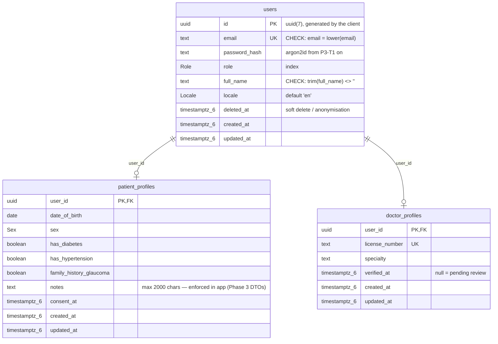

# Database documentation (Phase 2 · P2-T2)

Stack: **PostgreSQL 17 + PostGIS 3.5** (infra/docker-compose.yml), accessed through **Prisma ORM 7** (`prisma@7.10.1`, `@prisma/client@7.10.1` with the `@prisma/adapter-pg` driver adapter — Prisma 7 has no built-in Rust query engine; driver adapters are mandatory).

Project files: schema `backend/prisma/schema.prisma`, migrations `backend/prisma/migrations/`, Prisma CLI config `backend/prisma.config.ts`, seed `backend/prisma/seed.ts`.

## ER diagram



## Naming conventions

- Prisma model/field names are camelCase singular; **tables and columns are
  snake_case and plural**, mapped with `@@map` / `@map`
  (`User → users`, `PatientProfile → patient_profiles`, `passwordHash → password_hash`, …).
- **Enum values are stored lowercase** via `@map` on every enum member
  (`Role.PATIENT → 'patient'`). PostgreSQL enum *type* names keep the PascalCase
  Prisma name (`"Role"`, `"Locale"`, `"Sex"`).
- Primary keys are UUID **v7** (`@default(uuid(7))` — natively supported by
  Prisma 7): sortable, sequence-free.
- All timestamps are `timestamptz(6)`. Dates of birth are plain `date`.
- Profiles share the user's primary key (`userId` as PK = 1:1 without a join
  table) and hold `ON DELETE CASCADE` to `users`, so deleting an account
  removes the profile row.

## Migrations are append-only

A migration folder is **never edited after it has been applied anywhere**.
Only two edits are legitimate:

1. while creating a new migration with `--create-only`, before it is applied;
2. additive fixes via a NEW migration file.

Hotfixes of broken migrations use `prisma migrate resolve` (Patch/
hotfix workflow), not file edits.

## Running migrate / seed locally

Two connection contexts, **only the host differs**:

| Context                     | DATABASE_URL host | Notes                                                        |
| --------------------------- | ----------------- | ------------------------------------------------------------ |
| From the host (developer)   | `127.0.0.1:5432`  | values from `backend/.env` (mirrors `infra/.env`, untracked) |
| Inside the Docker container | `postgres:5432`   | the compose service name (see `infra/.env`)                  |

```bash
# 1) start the database
docker compose -f infra/docker-compose.yml --env-file infra/.env up -d postgres

# 2) host-side: create backend/.env from backend/.env.example (replace values)
#    DATABASE_URL host = 127.0.0.1 (postgres is published on 127.0.0.1 only)

# 3) create + apply a migration (host-side shell)
cd backend
npm run prisma:migrate:dev -- --create-only --name <name>   # then edit the SQL
npm run prisma:migrate:dev                                  # applies + regenerates client

# status/deploy
npm run prisma:migrate:status
npm run prisma:migrate:deploy      # CI/production: applies pending migrations only

# 4) seed (idempotent, refuses NODE_ENV=production)
npm run db:seed

# 5) container-side (after docker compose up -d): the DATABASE_URL host is the service name,
#    set by infra/docker-compose.yml — for example:
docker compose -f infra/docker-compose.yml --env-file infra/.env exec backend npm run prisma:generate
docker compose -f infra/docker-compose.yml --env-file infra/.env exec backend npm run prisma:migrate:status

# 6) development-only destructive reset (drops + replays; then re-seed)
npm run db:reset
npm run db:seed   # db:reset replays migrations but does NOT auto-run the seed with this CLI state
```

Note: `prisma migrate dev` in Prisma 7 does **not** always regenerate the
client after applying a migration — after editing the schema, run
`npm run prisma:generate` explicitly (the `prebuild`/`pretest` hooks cover
this for build/test, not for seeds on stale clients).

### Migrations are NOT run automatically

Nothing in the container entrypoint, compose, or CI applies migrations
automatically in this phase. Applying them stays a deliberate operation
(`prisma:migrate:deploy`, done by the deployment workflow in a later phase).

## Rules not expressible in the schema

- "A `doctor_profiles` row may only reference a user with `role = 'doctor'`
  (and a `patient_profiles` row only a `patient` user)" — a `CHECK` cannot
  reference another table. This is **enforced in the service layer from
  Phase 3 on**; the first migration documents it in SQL comments. A database
  trigger would be the strict alternative and is deliberately out of scope.
- "Emails are stored lowercase" and "full names are not blank" are enforced
  at database level via CHECK constraints added manually in the first
  migration (Prisma schemas cannot express column-level CHECKs).
- `notes` max length (2000 chars) is enforced by Phase 3 DTO validation, not
  by the database.

## Seed data

`npm run db:seed` upserts three clearly-fake accounts
(`seed.patient@example.com`, one verified + one unverified doctor with
`TEST-0001`/`TEST-0002` license numbers). Their `password_hash` is the
placeholder `!seed-placeholder-not-a-real-hash`, which is not a valid hash
of any scheme — seeded accounts cannot log in until P3-T1 (argon2id) ships.
